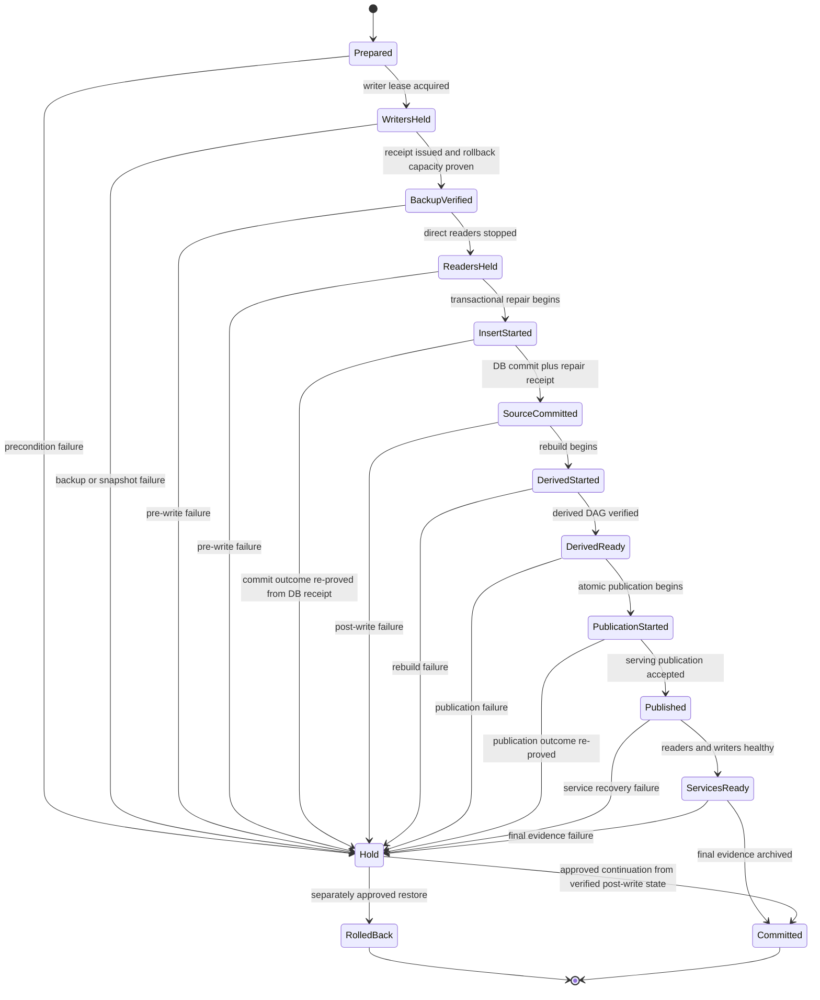

# Rollback State Model

## Current observation

`JpOhlcvRepairStage` contains forward, rollback, read-service, finalization, and
terminal states in one union. Additional approvals and orchestrators add process,
gateway, writer-resume, and recovery-continuation states outside that union. The
safety checks are valuable; the ownership model is not.

## Target transaction state

This is the transaction state only. The reader-hold and in-flight states are
included because they change observability or make crash outcome ambiguous. The
source commit receipt is persisted in the same SQLite transaction as the repair,
so a crash after COMMIT but before the external journal append is recoverable.
Writer lease, readiness polling, gateway migration, process supervision, and
backup verification remain evidence providers/adapters rather than separate
top-level recovery products.

## Event journal

Each transition appends one immutable event containing:

- transaction and approval identity;
- previous and next state;
- command/runtime identity;
- input evidence hashes;
- output receipt hashes;
- process identity and timestamps;
- operator action when entering HOLD.

A pure reducer reconstructs state. The reducer cannot inspect the filesystem or
launchd. Adapters gather evidence, and the transition command validates it.

## Recovery classes

| Last proven state | Permitted next action | Data restore required |
| --- | --- | --- |
| `Prepared` | archive pre-write HOLD | no |
| `WritersHeld` | release through approved pre-write recovery | no |
| `BackupVerified` | archive pre-write HOLD | no |
| `ReadersHeld` | release through approved pre-write recovery | no |
| `InsertStarted` | inspect transactional repair receipt, then continue or rollback | maybe |
| `SourceCommitted` | approved continuation or rollback | maybe |
| `DerivedStarted` | approved continuation or rollback | maybe |
| `DerivedReady` | approved publication continuation or rollback | maybe |
| `PublicationStarted` | re-prove manifest/pointer outcome | maybe |
| `Published` | service-only continuation if data/publication re-proves | no DB restore by default |
| `RolledBack` | service/writer finalization only | no repeated restore |

## Backup verification contract

`ArtifactVerificationReceipt` binds path, inode/object identity, size, SHA-256,
full `quick_check` result, SQLite journal normalization, source/serving identity,
tool/runtime identity, and completion time. It is valid only while the artifact
bytes and metadata match. Restore re-hashes the restored DB and requires exact
backup equality; it does not rerun the same full check solely because a process
boundary was crossed. Before writer hold, capacity preflight must prove space for
the live DB, backup, restore strategy, failed-state retention, and reserve. A
path/inode match is never a substitute for a fresh byte identity at a trust
boundary.

## Incident package boundary

The 2026-07-17 approved keys, conflicts, fixtures, and one-time commands remain
under an incident package. Permanent modules keep only generic provider,
coverage, transaction, backup receipt, and publication contracts proven useful
outside this incident.

After evidence-retention obligations expire, remove normal-runtime entrypoints
for emergency recovery package generation, resealing, transaction-specific
finalization, and 2026-07-17 fixtures. Preserve immutable evidence and a tested
offline replay tool; do not retain every incident orchestrator as a Production
feature.

## Completion criteria

- Crash/SIGKILL at every transition reconstructs one unambiguous state.
- Pre-write HOLD never requires DB restore.
- Restore is never repeated after restored bytes and generations are proven.
- Service/writer continuation cannot mutate DB or widen authorization.
- Journal and lock are never manually edited or deleted.
- Recovery tests include delayed readiness, partial writer restore, identity
  mismatch, stale PID reuse, and corrupted evidence.
